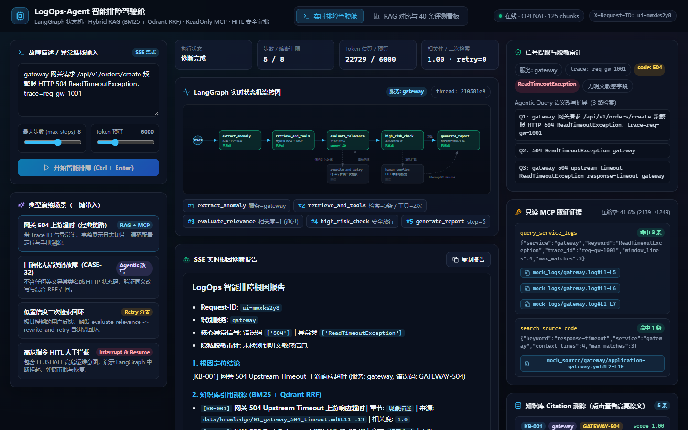
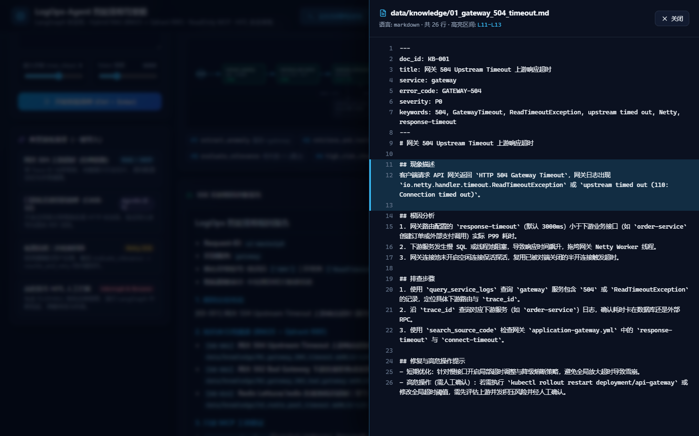
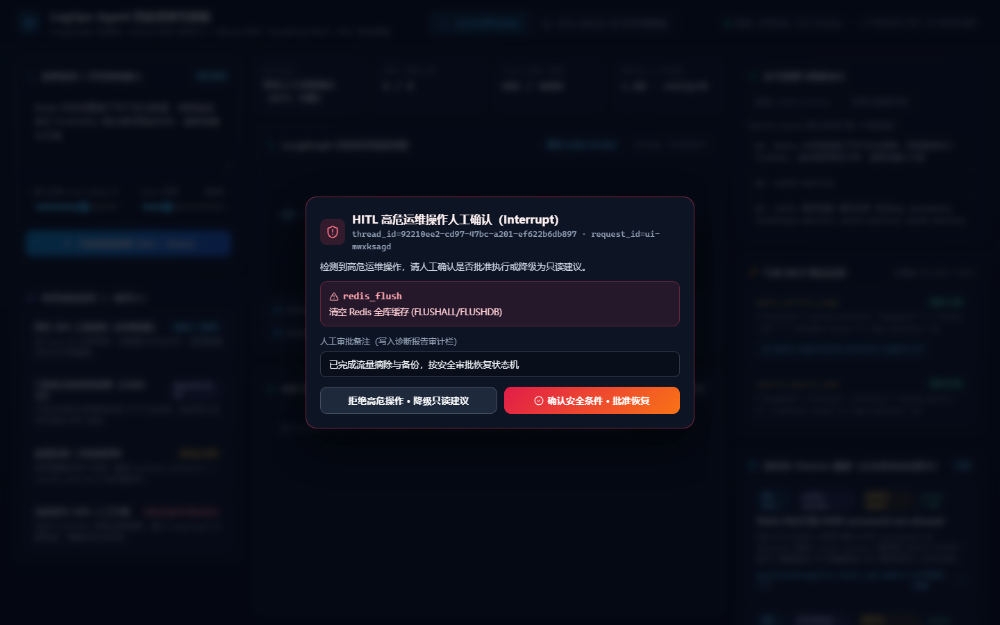
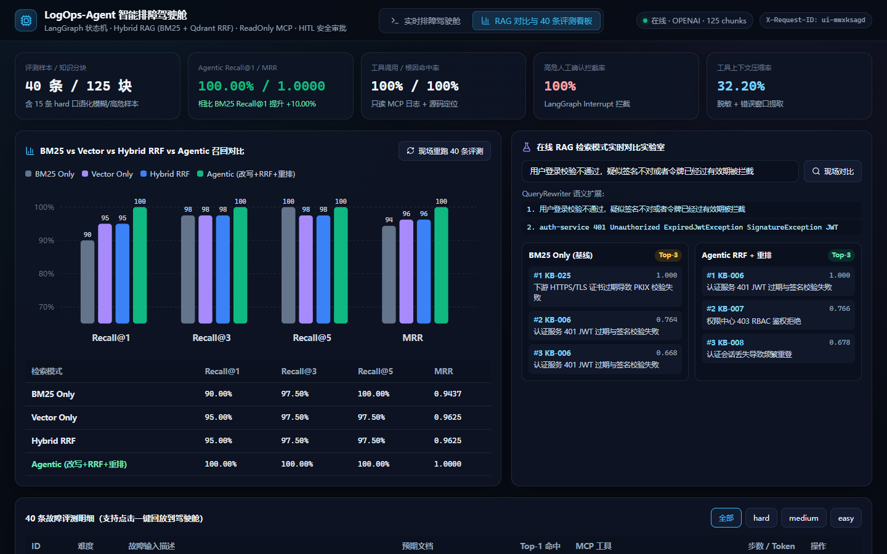

# LogOps-Agent 智能排障平台

基于 **FastAPI (SSE) + LangGraph 状态机 + Agentic Hybrid RAG (BM25 + Qdrant RRF) + 只读 MCP 工具 + 模型网关客户端 + React/Vite 流式排障驾驶舱** 的智能运维排障全栈应用。

输入故障描述或异常堆栈，系统自动完成隐私脱敏与异常信号提取，结合故障手册、模拟日志和源码片段流式生成带溯源引用的诊断报告；默认支持本地 `mock` 模式离线闭环，也支持对接本地 Java 模型网关 `yijia-ai-platform` 或公共 OpenAI 兼容大模型。

## 项目亮点

- **可视化流式排障驾驶舱（React + Vite）**：
  - 实时渲染 **LangGraph 7 节点状态机流转图**（含 `evaluate_relevance -> rewrite_and_retry` 自纠错回环与熔断直达路径）。
  - **SSE 流式诊断输出**，支持 `X-Request-ID` 透传展示与 `max_steps` / `token_budget` 熔断演示。
  - **HITL 高危操作人工确认弹窗（Interrupt & Resume）**：拦截 `FLUSHALL`、`kubectl delete pod`、`kill -9` 等高危操作，支持人工批准或降级为只读建议。
  - **右侧可点击 Citation 溯源高亮抽屉**：点击知识库引用或 MCP 命中日志/源码坐标，直接拉取原文并定位高亮对应行号区间。
  - **RAG 评测对比看板与在线实验室**：可视化对比 `bm25_only`、`vector_only`、`hybrid_rrf` 与 `agentic`，并支持 40 条评测样本一键回放演示。
- **可对比的检索链路**：BM25、本地哈希向量、RRF 融合，以及中文口语化同义改写与改写锚点加权重排；引用保留文档、章节和行号。
- **只读取证与安全隔离**：日志切片、源码定位工具及前端溯源接口均内置 Pydantic 校验、路径穿越拦截、敏感字段脱敏和上下文压缩；高危建议进入人工确认流程，系统不执行运维命令。
- **模型网关适配与真实联调**：提供 OpenAI 兼容客户端，支持 `X-Request-ID` 透传、429 退避重试和上游 SSE 解析，已完成与本地 `yijia-ai-platform` Java 网关及真实大模型 `gpt-5.6` 的端到端联调验证（详见 [docs/integration-verification.md](docs/integration-verification.md)）。

## 界面预览

| 实时排障驾驶舱（LangGraph 流转 + SSE 报告） | 可点击 Citation 源码/手册高亮抽屉 |
| :---: | :---: |
|  |  |

| HITL 高危操作人工确认弹窗（Interrupt） | BM25 vs Vector vs Agentic 40 条评测看板 |
| :---: | :---: |
|  |  |

## 目录结构

```text
logops-agent/
├── app/
│   ├── api/            # FastAPI 流式接口 (SSE)、人工确认恢复、只读溯源与评测看板接口
│   ├── agent/          # LangGraph 状态机 (异常提取 -> 混合检索/MCP取证 -> 相关性评估/二次检索 -> 高危确认 -> 报告生成)
│   ├── rag/            # Markdown 章节分块、BM25 + Qdrant(本地模式) RRF 混合检索、同义改写与重排
│   ├── mcp_tools/      # 只读 MCP 工具 (日志切片检索、源码关键词定位) + Pydantic 校验 + FastMCP Server
│   ├── context/        # 长堆栈敏感信息脱敏、错误窗口提取与 Tool Result 摘要压缩
│   └── gateway_client/ # 对接 Java「AI 模型接入与网关平台」/ OpenAI 兼容 API（含 429 指数退避、SSE 解析、Request-ID 透传）
├── frontend/           # React + Vite + TypeScript 流式排障驾驶舱与 Playwright E2E 验收脚本
├── data/
│   ├── knowledge/      # 25 篇后端与网关常见故障手册 Markdown（125 个分块，含 YAML Frontmatter 元数据）
│   ├── mock_logs/      # 7 个微服务的模拟故障日志
│   └── mock_source/    # 模拟 Java/YAML 故障源码片段
├── docs/               # 端到端联调验证记录与界面验收截图
├── eval/               # 40 条故障评测集（含 10 条无精确错误码口语化模糊故障）与实测报告
└── tests/              # 20 项 pytest 单元测试、API 集成测试与状态机边界测试
```

## 快速开始

### 1. 安装后端依赖并配置环境

需要 Python 3.11+（本次验证使用 Python 3.12）与 Node.js 20+：

```powershell
git clone https://github.com/yzxz111/logops-agent.git
cd logops-agent
py -3 -m venv .venv
.\.venv\Scripts\python.exe -m pip install -r requirements.txt
Copy-Item .env.example .env
```

### 2. 配置模型网关（可选，默认 `mock` 模式可离线闭环）

在 `.env` 中按需切换提供方；实际密钥仅保存在本地 `.env` 中：
- `LLM_PROVIDER=mock`：默认本地离线模式，无需外部模型服务即可跑通全链路、前端驾驶舱与 40 条评测。
- `LLM_PROVIDER=gateway`：连接 OpenAI 兼容模型网关（如本地 `yijia-ai-platform`：`http://127.0.0.1:18081/v1`）。
- `LLM_PROVIDER=openai`：对接公共 OpenAI 兼容模型 API。

### 3. 启动后端与 React + Vite 排障驾驶舱

**方式 A：开发模式（推荐，前后端热更新）**

```powershell
# 终端 1：启动 FastAPI 后端
.\.venv\Scripts\python.exe -m uvicorn app.api.main:app --host 127.0.0.1 --port 8000 --reload

# 终端 2：启动 React + Vite 驾驶舱（自动代理 /api 与 /health 到 8000）
cd frontend
npm install
npm run dev
```

启动后访问 **`http://127.0.0.1:5173`** 进入可视化排障驾驶舱（API 文档位于 `http://127.0.0.1:8000/docs`）。

**方式 B：单进程生产模式**

```powershell
cd frontend
npm install && npm run build
cd ..
.\.venv\Scripts\python.exe -m uvicorn app.api.main:app --host 127.0.0.1 --port 8000
```

若 `frontend/dist` 存在，FastAPI 会自动托管前端静态资源，直接访问 **`http://127.0.0.1:8000`** 即可。

核心接口：
- `GET /health`：健康检查与知识库索引分块统计
- `POST /api/v1/diagnose`：同步智能排障诊断
- `POST /api/v1/diagnose/stream`：SSE 流式诊断（实时推送节点增量、HITL 中断与报告分片，透传 `X-Request-ID`）
- `POST /api/v1/diagnose/{thread_id}/confirm`：高危指令人工确认恢复
- `POST /api/v1/rag/search`：混合 RAG 检索对比调试
- `GET /api/v1/source/file`：只读安全读取知识手册、日志与源码文件（用于前端 Citation 高亮抽屉）
- `GET /api/v1/eval/report` & `POST /api/v1/eval/run`：读取或现场重跑 40 条评测看板数据

### 4. 运行单元测试、40 条评测与 Playwright 界面验收

```powershell
# 运行全部 20 项 pytest 单元测试与接口集成测试
.\.venv\Scripts\python.exe -m pytest -v

# 运行 40 条故障评测集并生成 eval/eval_report.json 与 eval/eval_report.md
.\.venv\Scripts\python.exe -m eval.run_eval

# 运行前端 Playwright 全链路界面验收与截图（需先启动前后端服务）
cd frontend
npm run test:e2e
```

## 实测结果摘要（40 条评测集 / 20 项 pytest / E2E 验收）

以下结果于 **2026-11-26** 在本地环境复现。完整报告见 [eval/eval_report.md](eval/eval_report.md)，评测集见 [eval/dataset.json](eval/dataset.json)（已合入 `CASE-31` ~ `CASE-40` 共 10 条无精确错误码的口语化模糊故障）。

- **pytest 测试**：`20/20` 全部通过（涵盖 429 退避、SSE 解析、Request-ID 透传、RAG 溯源、MCP 路径防穿越、脱敏与压缩、二次检索、步数/Token 熔断、人工确认中断与恢复、溯源文件安全读取与评测看板接口）。
- **Playwright E2E 界面验收**：`4/4` 核心用户路径全部通过（流式排障状态机推演、Citation 高亮抽屉、HITL 弹窗中断与恢复、40 条评测看板渲染）。
- **RAG 检索对比（40 条样本 / 125 个分块）**：
  - `bm25_only`：`Recall@1 = 90.00%`，`Recall@3 = 97.50%`，`Recall@5 = 100.00%`，`MRR = 0.9437`
  - `vector_only`：`Recall@1 = 95.00%`，`Recall@3 = 97.50%`，`Recall@5 = 97.50%`，`MRR = 0.9625`
  - `hybrid_rrf`：`Recall@1 = 95.00%`，`Recall@3 = 97.50%`，`Recall@5 = 97.50%`，`MRR = 0.9625`
  - `agentic`（同义 Query 改写 + 多路 RRF + 改写锚点多样性重排）：`Recall@1 = 100.00%`，`Recall@3 = 100.00%`，`Recall@5 = 100.00%`，`MRR = 1.0000`（相比纯 BM25 `Recall@1` 提升 **+10.00%**）
- **Agent 全链路能力**：工具调用准确率 `100.00%`、根因命中率 `100.00%`、高危指令人工确认拦截率 `100.00%`（2/2）、工具上下文压缩率 `32.20%`。

## 实现范围与评测口径

- 故障手册、日志、源码片段和 40 条评测集为仓库内置材料，日志中的账号、手机号及密钥形状字符串仅用于脱敏测试；评测脚本运行在确定性本地 `mock` 模式，未代表生产环境真实准确率。
- 检索指标按去重文档的前 K 个结果中是否包含预期文档计算；工具指标检查预期工具集合是否被调用，根因指标检查输出是否包含任一预期关键词。
- 端到端真实模型与 Java 网关联调结果单独记录于 [docs/integration-verification.md](docs/integration-verification.md)。
- 人工确认仅控制报告建议与状态机恢复；工具与文件溯源接口始终只读。会话检查点保存在内存中；服务未启用租户隔离，建议用于本地演示与技术评估。
